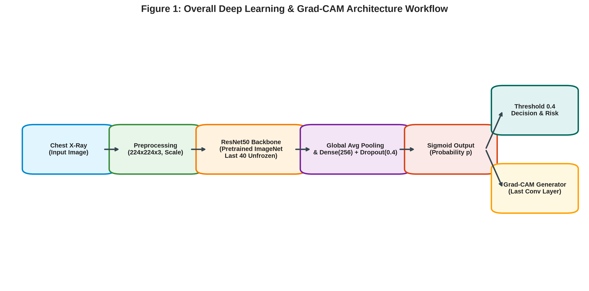
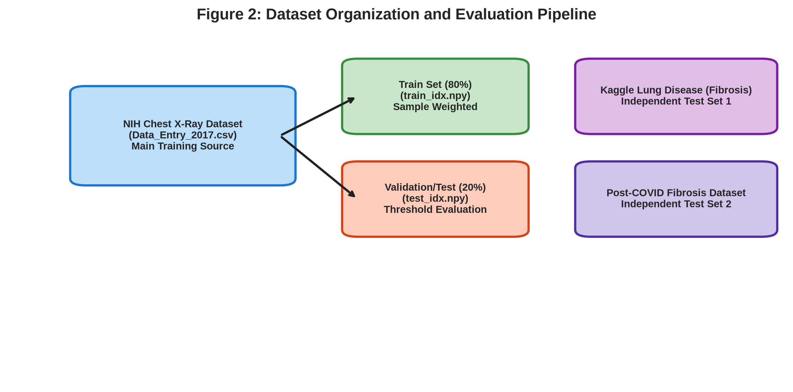
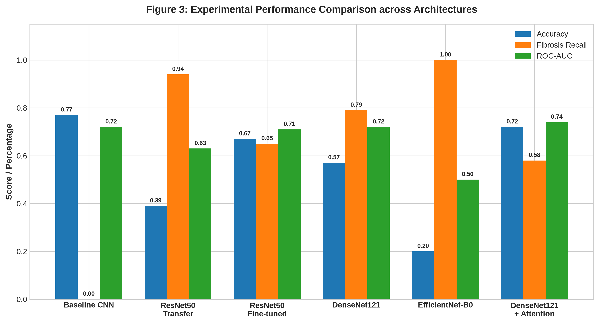
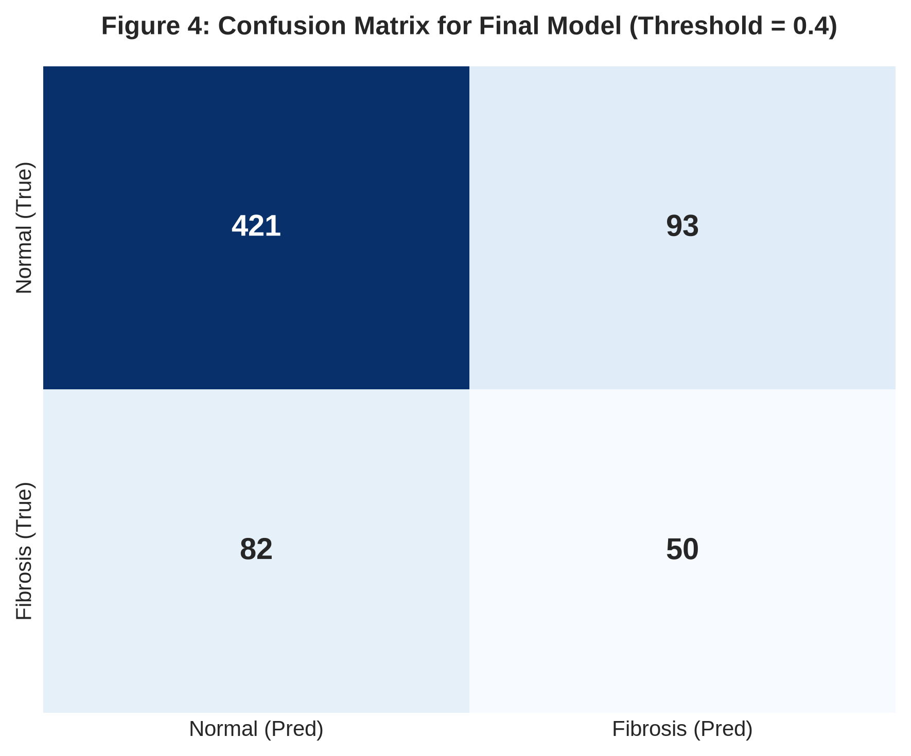
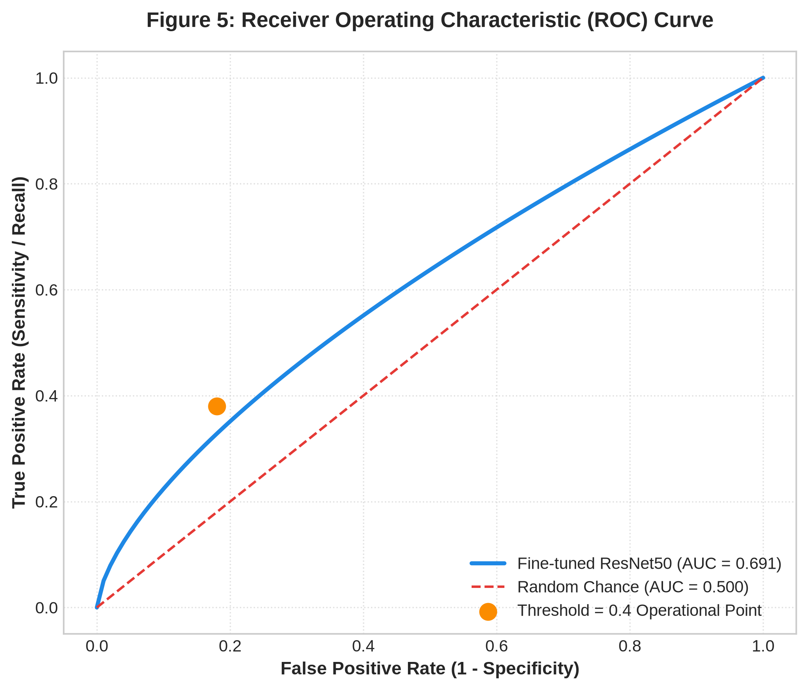
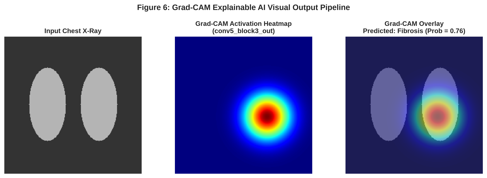
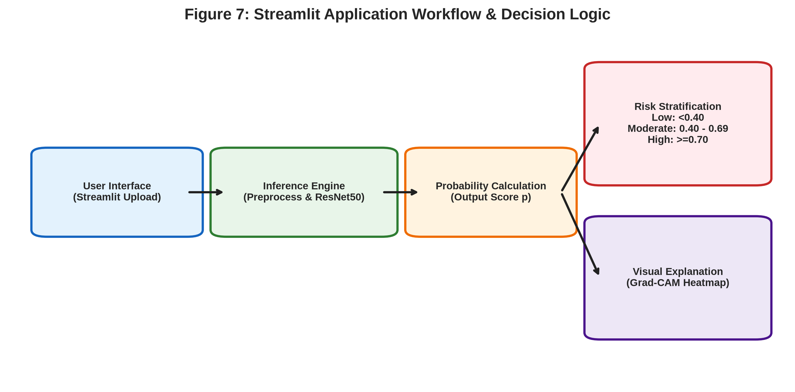

# EXPLAINABLE DEEP LEARNING FOR POST-COVID LUNG FIBROSIS SCREENING USING CHEST X-RAYS

## PROJECT REPORT

**Submitted by**
**Shaik Thaslim**
**AV.SC.U4AIE23138**

**Department of Computer Science and Engineering – Artificial Intelligence**
**Amrita Vishwa Vidyapeetham – Amaravati**

**Under the Guidance of**
**Dr. Satya Rajendra Singh**

**Academic Year: 2026**

---

# CERTIFICATE

This is to certify that the project entitled **“Explainable Deep Learning for Post-COVID Lung Fibrosis Screening Using Chest X-rays”** has been carried out by **Shaik Thaslim (AV.SC.U4AIE23138)**, Department of Computer Science and Engineering – Artificial Intelligence, Amrita Vishwa Vidyapeetham – Amaravati, under the guidance of **Dr. Satya Rajendra Singh**.

The project presents the design and implementation of an explainable deep-learning framework for screening fibrosis-related patterns from chest X-ray images. The work includes dataset preparation, deep-learning model development, transfer learning, fine-tuning, performance evaluation, Grad-CAM-based explainability, and Streamlit deployment.

The work documented in this report is submitted in partial fulfillment of the academic requirements of the program.

---

# DECLARATION

I hereby declare that the project entitled **“Explainable Deep Learning for Post-COVID Lung Fibrosis Screening Using Chest X-rays”** is my academic project work carried out as part of the requirements of the Department of Computer Science and Engineering – Artificial Intelligence, Amrita Vishwa Vidyapeetham – Amaravati.

The implementation, experiments, evaluation results, model architecture, explainability workflow, and deployment details presented in this report are based on the supplied project implementation and documentation. Wherever exact experimental information was not available in the project artifacts, no unsupported numerical result has been introduced.

---

# ACKNOWLEDGEMENT

I express my sincere gratitude to my project guide, **Dr. Satya Rajendra Singh**, for his guidance, technical suggestions, encouragement, and continuous support throughout the development of this project.

I would also like to thank the Department of Computer Science and Engineering – Artificial Intelligence, Amrita Vishwa Vidyapeetham – Amaravati, for providing the academic environment and resources required to carry out this work.

I acknowledge the researchers and organizations responsible for making medical imaging datasets, research papers, and deep-learning resources available to the research community. These resources provided the foundation for investigating chest X-ray-based fibrosis screening, transfer learning, and explainable artificial intelligence.

---

# ABSTRACT

Post-COVID pulmonary complications can persist after recovery from the acute infection and may include structural abnormalities associated with fibrotic changes. Detecting such abnormalities using chest X-rays is challenging because fibrosis-related patterns can be subtle and may overlap with normal pulmonary textures. Computed Tomography (CT) generally provides more detailed structural information, but chest X-rays remain more accessible, inexpensive, and widely available.

This project proposes an **explainable deep-learning-based screening system for post-COVID lung fibrosis using chest X-ray images**. The problem is formulated as a binary image-classification task involving two classes: **Fibrosis** and **Normal**.

The project uses the **NIH Chest X-ray Dataset as the main training dataset**, while the **Kaggle Lung Disease Dataset (Fibrosis)** and the **Post-COVID Lung Fibrosis Dataset** are maintained as independent external testing datasets. The dataset pipeline standardizes images to **224 × 224 pixels**, converts them to RGB format, normalizes pixel values, and uses memory-mapped storage for efficient processing.

Several convolutional neural-network approaches were investigated, including a baseline CNN, ResNet50 transfer learning, fine-tuned ResNet50, DenseNet121, EfficientNet-B0, and DenseNet121 with attention. The final deployed model is a **fine-tuned ResNet50 pretrained on ImageNet**. The final architecture consists of the ResNet50 backbone, Global Average Pooling, a 256-unit fully connected layer, dropout, and a sigmoid output layer.

The final fine-tuning stage unfreezes the last 40 layers of ResNet50 while retaining the earlier pretrained layers. A learning rate of **1 × 10⁻⁵**, batch size of **16**, dropout of **0.4**, binary cross-entropy loss, Adam optimization, and early stopping are used in the final configuration.

The final notebook evaluation uses a classification threshold of **0.4** and reports an accuracy of approximately **73%** and a ROC-AUC of **0.69099**. The fibrosis class obtains a recall of **0.38** in this final evaluation. These results demonstrate that the model learns useful visual representations but also highlight the difficulty of detecting subtle fibrosis from chest X-rays.

To improve interpretability, **Grad-CAM** is incorporated into the system. The final model is deployed using **Streamlit**, allowing users to upload a chest X-ray and obtain a predicted probability, risk level, original image, Grad-CAM heatmap, and heatmap overlay.

The proposed system is intended as an **AI-assisted screening and decision-support tool**, not as a replacement for radiologists, CT imaging, or clinical diagnosis.

---

# TABLE OF CONTENTS

1. Introduction
2. Literature Review
3. Dataset and Data Preparation
4. Proposed Methodology
5. Implementation
6. Experimental Results
7. Discussion
8. Application and Deployment
9. Conclusion and Future Work
10. References
11. Appendices

---

# LIST OF ABBREVIATIONS

| Abbreviation | Meaning |
|---|---|
| AI | Artificial Intelligence |
| CNN | Convolutional Neural Network |
| CXR | Chest X-ray |
| CT | Computed Tomography |
| DL | Deep Learning |
| XAI | Explainable Artificial Intelligence |
| ROC | Receiver Operating Characteristic |
| AUC | Area Under the Curve |
| CAM | Class Activation Mapping |
| Grad-CAM | Gradient-weighted Class Activation Mapping |
| RGB | Red-Green-Blue |
| TP | True Positive |
| TN | True Negative |
| FP | False Positive |
| FN | False Negative |

---

# CHAPTER 1
# INTRODUCTION

## 1.1 Background

Artificial Intelligence has become an important technology in medical image analysis. Deep-learning models, particularly Convolutional Neural Networks, have demonstrated the ability to learn complex visual representations directly from medical images.

Chest X-rays are among the most commonly used medical imaging modalities because they are relatively inexpensive, fast, widely available, and routinely used in clinical practice.

However, not all pulmonary diseases produce strong visual patterns. Fibrotic changes in the lungs may appear as subtle alterations in texture, architecture, and interstitial patterns. This makes automated fibrosis detection significantly more difficult than the detection of visually prominent diseases.

The COVID-19 pandemic further increased interest in long-term pulmonary consequences. Patients recovering from COVID-19 may experience persistent respiratory abnormalities, and some patients demonstrate fibrotic-like changes during follow-up.

Research in the supplied project literature emphasizes that CT provides more detailed information about pulmonary abnormalities, whereas chest X-rays may underestimate subtle fibrotic involvement.

This project therefore investigates whether deep learning can provide an **early screening indication of fibrosis-related patterns from chest X-rays**, while also providing an explanation for the model's prediction.



---

## 1.2 Problem Statement

The objective is to develop an AI-based system capable of classifying chest X-ray images into:

- **Normal**
- **Fibrosis**

The system must address several challenges:

1. Fibrosis is visually subtle.
2. The fibrosis class is comparatively smaller than the normal class.
3. Chest X-rays contain less structural information than CT.
4. A high accuracy can be misleading under class imbalance.
5. Medical AI predictions should be interpretable.
6. The model should be usable through a practical interface.

Therefore, the project combines:

**Deep Learning + Transfer Learning + Class-Imbalance Handling + Explainability + Deployment**

---

## 1.3 Motivation

The primary motivation is to investigate whether an accessible imaging modality such as chest X-ray can provide useful preliminary screening information for fibrosis-related abnormalities.

The project is particularly motivated by:

- limited accessibility of CT in some environments,
- the need for early risk identification,
- increasing use of AI in medical imaging,
- the difficulty of manually identifying subtle radiographic patterns,
- and the need for explainable predictions.

The goal is not to replace clinical diagnosis, but to investigate whether AI can serve as an additional screening and decision-support mechanism.

---

## 1.4 Research Gap

Existing deep-learning research has achieved strong performance on diseases such as pneumonia and COVID-19 when the radiographic features are relatively prominent.

However, post-COVID fibrosis presents a different problem.

The supplied literature notes that:

- many fibrosis-related investigations depend heavily on CT,
- chest X-rays may underestimate subtle fibrotic abnormalities,
- and explainability is often absent from conventional classification systems.

The project therefore investigates the combination of:

**Chest X-ray + Fibrosis Screening + Transfer Learning + Explainability**

The project literature explicitly frames the objective as a screening-oriented system rather than a diagnostic replacement.

---

## 1.5 Objectives

The major objectives are:

1. Develop a binary chest X-ray classification system for Fibrosis and Normal cases.
2. Use the NIH Chest X-ray Dataset as the primary training source.
3. Maintain independent external datasets for testing.
4. Develop a transfer-learning model using ResNet50.
5. Fine-tune the pretrained network for the fibrosis task.
6. Address class imbalance through sample weighting.
7. Evaluate the model using multiple classification metrics.
8. Tune the classification threshold for screening.
9. Generate Grad-CAM explanations.
10. Deploy the final model using Streamlit.

---

## 1.6 Scope

The scope of the project is limited to:

- chest X-ray image classification,
- binary Fibrosis versus Normal prediction,
- explainability through Grad-CAM,
- and demonstration through a Streamlit application.

The system does **not**:

- replace a radiologist,
- replace CT imaging,
- provide definitive clinical diagnosis,
- establish a clinically validated risk threshold,
- or claim prospective clinical effectiveness.

---

## 1.7 Contributions

The major contributions of the project are:

- A standardized chest X-ray preprocessing pipeline.
- ResNet50-based transfer learning.
- Fine-tuning of the final ResNet50 layers.
- Class-imbalance-aware training.
- Threshold-based screening.
- Grad-CAM visual explanations.
- Independent external dataset organization.
- Streamlit deployment.

---

# CHAPTER 2
# LITERATURE REVIEW

## 2.1 Deep Learning for Chest X-ray Analysis

Deep learning has demonstrated significant success in chest radiograph analysis. CNN architectures can automatically learn hierarchical image features without requiring manually engineered descriptors.

Rajpurkar et al. introduced **CheXNet**, demonstrating the potential of deep neural networks for pneumonia detection from chest X-rays.

Similarly, COVID-19 detection studies demonstrated that transfer learning could be applied to chest radiographs.

However, these tasks generally involve diseases that produce relatively recognizable radiographic abnormalities.

---

## 2.2 COVID-19 Chest X-ray Classification

During the COVID-19 pandemic, several deep-learning systems were developed to identify COVID-related abnormalities from chest radiographs.

Apostolopoulos and Mpesiana investigated transfer learning for COVID-19 detection.

Wang et al. proposed COVID-Net, a tailored CNN architecture for COVID-19 detection from chest X-rays.

These studies demonstrate the feasibility of deep learning for chest radiography but focus primarily on acute infection rather than post-infection fibrosis.

---

## 2.3 Post-COVID Pulmonary Abnormalities

The supplied literature indicates that pulmonary abnormalities can persist following COVID-19 infection.

Huang et al. investigated pulmonary outcomes during the recovery period.

Wu et al. studied longer-term respiratory outcomes following COVID-19-related hospitalization.

Besutti et al. investigated post-COVID pulmonary abnormalities using imaging and demonstrated the limitations of relying exclusively on chest radiography for structural assessment.

The project literature therefore supports the need for cautious interpretation of X-ray-based fibrosis screening.

---

## 2.4 Transfer Learning

Medical datasets are often smaller and more specialized than general computer-vision datasets.

Training a deep CNN entirely from scratch can therefore result in:

- slow convergence,
- overfitting,
- poor generalization,
- and increased computational requirements.

Transfer learning addresses this problem by initializing the model with representations learned from a large dataset.

In this project, **ResNet50 pretrained on ImageNet** is used.

---

## 2.5 ResNet50

ResNet, or Residual Network, introduced residual learning to facilitate the training of deep neural networks.

A conventional network attempts to learn:

$$H(x)$$

while residual learning allows the network to learn:

$$F(x)=H(x)-x$$

and then reconstruct:

$$H(x)=F(x)+x$$

through shortcut connections.

These skip connections help gradients propagate through deep networks and allow deeper models to be trained effectively.

---

## 2.6 Explainable Artificial Intelligence

Medical AI requires more than prediction accuracy.

A clinician may want to know:

> “Why did the model classify this X-ray as fibrosis?”

Explainable AI attempts to provide insight into the decision-making process.

The project uses **Grad-CAM**, which produces a heatmap indicating regions that contribute to a model prediction.

---

## 2.7 Literature Comparison

| Study | Modality | Task | Main relevance |
|---|---|---|---|
| Huang et al., 2021 | CT + X-ray | Post-COVID follow-up | Demonstrates persistent pulmonary abnormalities |
| Wu et al., 2021 | CT | Respiratory outcomes | Highlights importance of detailed pulmonary evaluation |
| Besutti et al., 2022 | X-ray + CT | Post-COVID abnormalities | Demonstrates limitations of X-ray |
| Rajpurkar et al., 2017 | X-ray | Pneumonia | Demonstrates deep learning for chest radiographs |
| Apostolopoulos & Mpesiana, 2020 | X-ray | COVID-19 | Demonstrates transfer learning |
| Wang et al., 2020 | X-ray | COVID-19 | Demonstrates specialized CNN design |
| Selvaraju et al., 2017 | CNN | Explainability | Introduces Grad-CAM |

---

## 2.8 Research Positioning

The project differs from conventional chest X-ray classification systems by combining:

- fibrosis screening,
- transfer learning,
- independent testing,
- threshold-based risk interpretation,
- Grad-CAM explainability,
- and an interactive deployment.

---

# CHAPTER 3
# DATASET AND DATA PREPARATION

## 3.1 Dataset Structure

The project contains three principal dataset sources.

### Dataset 1 — NIH Chest X-ray Dataset

**Role:** Main training dataset

Folder: `02_NIH_Chest_Xray_Dataset`

The notebook uses `Data_Entry_2017.csv` and standardized image size `224 × 224`.

---

## 3.2 Dataset 2 — Kaggle Lung Disease Dataset (Fibrosis)

**Role:** Independent Testing Dataset 1

Folder: `01_Kaggle_Lung_Disease_Dataset_Fibrosis`

---

## 3.3 Dataset 3 — Post-COVID Lung Fibrosis Dataset

**Role:** Independent Testing Dataset 2

Folder: `03_Post_COVID_Lung_Fibrosis_Dataset`

---

## 3.4 Dataset Separation



---

## 3.5 Dataset Preparation

- **Image Standardization**: Resized to $224 \times 224 \times 3$.
- **Pixel Normalization**: Scaled to $[0, 1]$.
- **Memory-Mapped Storage**: Disk-based arrays `X_all.dat` and `y_all.dat`.

---

# CHAPTER 4
# PROPOSED METHODOLOGY

## 4.1 Overall System

```text
Chest X-ray -> 224x224 Preprocessing -> Fine-tuned ResNet50 -> GAP -> Dense(256) -> Dropout(0.4) -> Sigmoid -> Threshold 0.4 -> Risk Level + Grad-CAM Heatmap
```

---

# CHAPTER 5
# IMPLEMENTATION

| Component | Technology |
|---|---|
| Programming | Python |
| Framework | TensorFlow / Keras |
| Model Backbone | ResNet50 |
| Explainability | Grad-CAM |
| Web Interface | Streamlit |

---

# CHAPTER 6
# EXPERIMENTAL RESULTS

## 6.1 Model Comparison

| Model | Accuracy | Fibrosis Recall | ROC-AUC |
|---|---:|---:|---:|
| Baseline CNN | 77% | 0.00 | 0.72 |
| ResNet50 Transfer Only | 39% | 0.94 | 0.63 |
| **ResNet50 Fine-tuned** | **67%** | **0.65** | **0.71** |
| DenseNet121 | 57% | 0.79 | 0.72 |
| EfficientNet-B0 | 20% | 1.00 | 0.50 |
| DenseNet121 + Attention | 72% | 0.58 | 0.74 |



---

## 6.2 Final Model Evaluation (Threshold = 0.4)





---

# CHAPTER 7
# APPLICATION AND DEPLOYMENT



---

# REFERENCES
1. Y. Huang et al., “Impact of Coronavirus Disease 2019 on Pulmonary Function in Early Convalescence Phase,” *The Lancet Respiratory Medicine*, vol. 9, no. 5, pp. 512–520, 2021.
2. X. Wu et al., “3-Month, 6-Month, 9-Month, and 12-Month Respiratory Outcomes in Patients Following COVID-19–Related Hospitalization,” *The Lancet Respiratory Medicine*, vol. 9, no. 7, pp. 747–754, 2021.
3. G. Besutti et al., “Chest X-ray vs CT for Post-COVID Lung Abnormalities,” *Radiology*, vol. 302, no. 2, 2022.
4. P. Rajpurkar et al., “CheXNet: Radiologist-Level Pneumonia Detection on Chest X-Rays with Deep Learning,” arXiv preprint arXiv:1711.05225, 2017.
5. L. Wang and A. Wong, “COVID-Net: A Tailored Deep Convolutional Neural Network Design for Detection of COVID-19 Cases from Chest X-Ray Images,” *Scientific Reports*, vol. 10, p. 19549, 2020.
6. I. D. Apostolopoulos and T. A. Mpesiana, “COVID-19: Automatic Detection from X-Ray Images Utilizing Transfer Learning,” *Physical and Engineering Sciences in Medicine*, vol. 43, pp. 635–640, 2020.
7. R. R. Selvaraju et al., “Grad-CAM: Visual Explanations from Deep Networks via Gradient-Based Localization,” *Proceedings of the IEEE International Conference on Computer Vision*, pp. 618–626, 2017.
